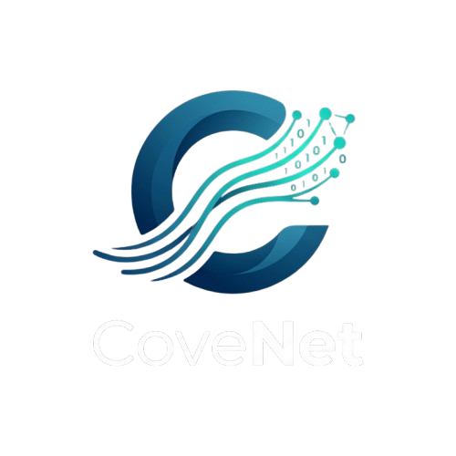
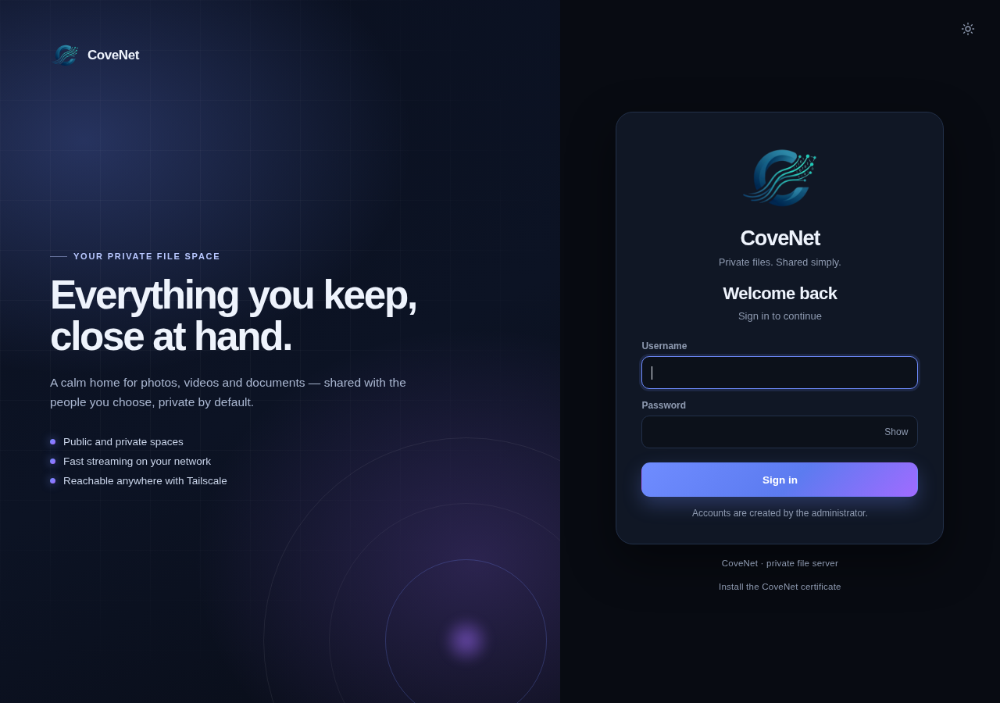
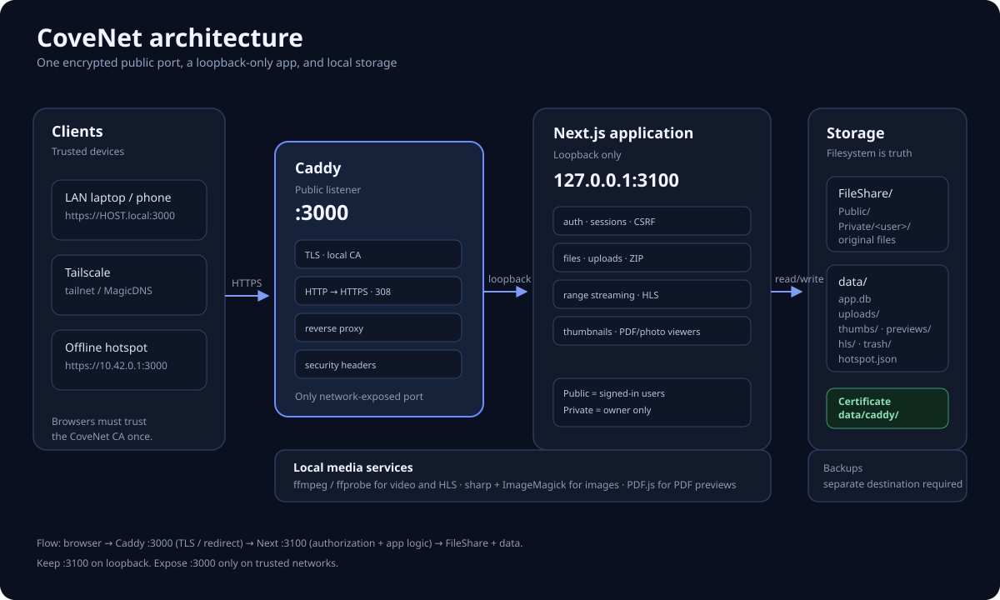
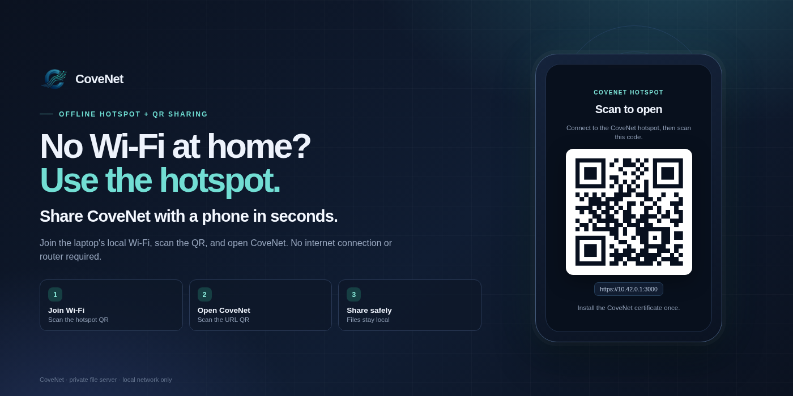

<p align="center">
  
</p>

# CoveNet

Private file and media server for a trusted LAN. Upload, browse, stream and share
files between accounts — with per-user private storage, two-factor auth and audit
logging.

```
Next.js 16 · SQLite · local filesystem · ffmpeg · sharp
```

Source: <https://github.com/szsuzan/covenet-localnetworkfilemanager>

## Preview

<p align="center">
  
</p>

## Architecture

<p align="center">
  
</p>

A browser reaches **Caddy on port 3000**. Caddy terminates TLS, redirects plain
HTTP, and proxies to **Next.js on loopback port 3100**. The app reads original
files from `FileShare` and keeps SQLite, uploads, trash and media caches under
`data/`. Tailscale and the optional hotspot reach the same port.

See [trust boundaries](docs/assets/trust-boundaries.svg) and
[storage/backup layout](docs/assets/storage-backup.svg).

## Documentation

- [User guide](docs/USER_GUIDE.md) — sign in, spaces, uploads, viewers, trash
- [Admin guide](docs/ADMIN_GUIDE.md) — users, permissions, cleanup, hotspot
- [Operations](docs/OPERATIONS.md) — install, services, certificates, backups, troubleshooting
- [Development](docs/DEVELOPMENT.md) — code map, request flow, verification
- [Security model](SECURITY.md) and [security audit](SECURITY_AUDIT.md)
- Diagrams: [architecture](docs/assets/architecture.svg), [trust boundaries](docs/assets/trust-boundaries.svg), [storage and backups](docs/assets/storage-backup.svg)

## Access

- **https://HOST.local:3000** (mDNS — follows IP changes on the same LAN)
- Current LAN address: **https://LAN-IP:3000**
- Port 3000 serves **HTTPS**; plain `http://` gets a `308` redirect to the same
  URL over HTTPS. UFW allows 3000 from `LAN-SUBNET`, `tailscale0` and the
  hotspot subnet. The manual UFW commands are in
  [Operations](docs/OPERATIONS.md#firewall).

### First time on each device

CoveNet uses a local certificate authority (Caddy internal CA). On the first visit
the browser will warn; continue to the login page and click **Install the CoveNet
certificate** (`/cove-ca.crt`). Trust it as a root/CA, then reload. The
certificate covers `HOST.local`, the current LAN IP, the hotspot IP
`10.42.0.1`, the Tailscale IP and the MagicDNS name.

After a LAN or Tailscale IP change, re-run:

```bash
./deploy/issue-cert.sh
```

It refreshes the certificate and CA download. It also restarts Caddy.

### Changing networks

`HOST.local` is advertised by Avahi and points at whatever address the machine has,
so it keeps working when DHCP hands out a new IP. It needs multicast/mDNS to be
allowed on the network (most home/office Wi-Fi allows it; guest Wi-Fi and
client-isolated networks often do not). The stable URL is `HOST.local`; the IP is
only a fallback.

- If you reserve an address on the router, reserve the laptop’s **current**
  address for its MAC. Re-run `./deploy/issue-cert.sh` if that address changes.

### Remote access with Tailscale (any network)

Tailscale gives the machine a stable `100.x.y.z` address and a MagicDNS name that
work from any network, without exposing CoveNet to the internet.

```bash
sudo tailscale up
sudo tailscale set --operator="$USER"
sudo ufw allow in on tailscale0 to any port 3000 proto tcp comment 'CoveNet Tailscale'
sudo ufw allow in on tailscale0 to any port 3000 proto udp comment 'CoveNet Tailscale'
```

Use:

- `https://TAILSCALE-IP:3000` or
- `https://HOST.TAILNET.ts.net:3000`

Install the CoveNet CA on the remote device once (same `/cove-ca.crt` link).
Traffic is encrypted by both WireGuard and CoveNet TLS. Port 3000 is the only
inbound port.

Get the name/IP with:

```bash
tailscale status
tailscale ip -4
```

### No Wi-Fi: run a hotspot

<p align="center">
  
</p>

**No Wi-Fi at home? Use the CoveNet hotspot and QR codes to share easily.** The
laptop creates a local Wi-Fi network; phones join it, scan the QR, and open
CoveNet without a router or internet connection. CoveNet keeps running when the
network disappears; only the address changes.

**Option A — use the laptop as the hotspot (with in-app QR sharing)**

Install the helper once (needs internet for `dnsmasq`):

```bash
sudo ./scripts/install-hotspot.sh
```

Then in **Admin → Offline hotspot**:

1. Choose an SSID and password
2. Click **Start hotspot**
3. Scan **1 · Join Wi-Fi**, then **2 · Open CoveNet**

Starting it disconnects the laptop from its current Wi-Fi, so open the admin
page on the laptop at `https://127.0.0.1:3000` first (the certificate includes
`127.0.0.1`). The Start button is disabled on non-local addresses because the
request would be cut off when Wi-Fi changes.

The laptop has one Wi-Fi radio, so **the laptop loses its normal Wi-Fi/internet
while the hotspot is running**. The hotspot is local-only. If you need internet
on the laptop too, use Ethernet or a second Wi-Fi adapter as the upstream.

No internet is needed — the hotspot is just a local network. Phones may warn
“no internet” or try to switch to mobile data; keep them connected. The QR URL
is `https://10.42.0.1:3000`; on a new phone, bypass the certificate warning once
and install the CoveNet CA from the login page. `HOST.local` may also work if the
client supports mDNS.

**Option B — use your phone’s hotspot**

Turn on the phone hotspot and connect the laptop to it. Then:

```bash
ip -4 addr show WIFI-INTERFACE          # find the laptop's hotspot IP/subnet
sudo ufw allow from <subnet>/24 to any port 3000 proto tcp comment 'CoveNet hotspot'
```

Open `https://<laptop-hotspot-ip>:3000` from the phone or any other device on
that hotspot (trust the CoveNet CA once). Common subnets are `192.168.43.0/24`
(Android) and `172.20.10.0/28` (iPhone); the generated certificate covers only
the laptop’s own `10.42.0.1` hotspot, so re-run `./deploy/issue-cert.sh` if you
use a different subnet.

**Notes**

- Tailscale needs internet; with no internet, use the hotspot IP instead.
- With no network at all, CoveNet still works on the laptop itself at
  `https://127.0.0.1:3000`.

TLS is terminated by Caddy on port 3000; Next listens only on
`127.0.0.1:3100`. See [SECURITY.md](SECURITY.md) for the certificate model.

## First login

The initial admin account is `admin`. On a fresh database, sign in with the
password from `ADMIN_PASSWORD` and change it when prompted. New passwords require
at least 8 characters and 3 of: lowercase, uppercase, numbers, symbols.

## Features

- Public space (everyone) and per-user Private space (owner only)
- Share a Private folder read-only with selected users through **Shared with me**
- Grid/list browsing, breadcrumbs, filename search, recent uploads, favorites
- Multi-select, bulk ZIP download, folder download as ZIP, bulk cut/delete
- Drag-and-drop, whole-folder and phone-camera uploads; pause/resume/cancel
- Delete to trash with restore; automatic purge after 30 days
- Image, folder and PDF thumbnails; image lightbox; video streaming with resume position
- Automatic HLS transcoding for MKV/HEVC/AVI and other non-native formats
- Audio, PDF and text preview
- Admin: users, roles, upload permission, reset password/2FA, storage dashboard,
  cleanup, audit log
- Dark and light themes; keyboard shortcuts (`/` search, `Ctrl+A` select all,
  `Delete`, `Esc`)

## Security

See [SECURITY.md](SECURITY.md) for the threat model, and
[SECURITY_AUDIT.md](SECURITY_AUDIT.md) for the latest audit, test matrix and
remaining actions. Summary:

- HTTPS on port 3000 (Caddy internal CA); Next is loopback-only on `3100`
- Session cookie `__Host-cove`, `Secure`, `HttpOnly`, `SameSite=Lax`; tokens stored hashed
- 30-day absolute / 7-day idle sessions, max 10 per user, revoke-all
- bcrypt (cost 12), password policy, forced change of the default password
- Persisted login throttling (10 failures per account; 40 per IP as well when behind a trusted proxy)
- Optional TOTP two-factor authentication with QR setup
- CSRF protection via Origin + `Sec-Fetch-Site` checks on every mutation
- Strict security headers and CSP; `X-Frame-Options`, `nosniff`, no-referrer
- Path-traversal and symlink-escape guard on every file operation; private folders isolated per user
- SVG/HTML/XML/JS forced to download (no stored XSS); ZIP skips symlinks
- Upload chunk and file-size caps
- Audit log of logins, uploads, deletes, admin actions and password/2FA changes

## Storage

`STORAGE_ROOT` is set in `.env.local`; the example below uses `/srv/cove/files`:

```
Public/                 visible to every signed-in user
Private/<username>/     visible only to that user
```

App data lives in `data/`:

```
app.db      users, sessions, favorites, watch progress, audit log, throttle
uploads/    in-progress chunked uploads
thumbs/     thumbnail cache
hls/        transcoded video cache
trash/      deleted items (30-day retention)
```

The filesystem is the source of truth. Hidden entries and symlinks are never listed.

## Configuration (`.env.local`)

```ini
STORAGE_ROOT=/srv/cove/files
ADMIN_USERNAME=admin
ADMIN_PASSWORD=change-me-before-first-start
COOKIE_SECURE=1          # Secure __Host- cookie; requires HTTPS
TRUST_PROXY=1            # Caddy overwrites X-Forwarded-For
SESSION_IDLE_DAYS=7
MAX_UPLOAD_GB=200

TRANSCODE_CONCURRENCY=2
THUMB_CONCURRENCY_IMAGES=4
THUMB_CONCURRENCY_VIDEOS=2

UPLOAD_STALE_HOURS=24
TRASH_RETENTION_DAYS=30
HLS_RETENTION_DAYS=7
HLS_MAX_GB=10
THUMB_RETENTION_DAYS=90
THUMB_MAX_GB=2
CLEANUP_INTERVAL_HOURS=6
```

Cleanup runs every 6 hours and on the first page load. Admins can trigger it
immediately with **Run cleanup**; the admin action also clears the video,
thumbnail and preview caches. The scheduled run only applies retention limits.

## Services

The app runs as user-level units: `fileshare` (Next on `127.0.0.1:3100`) and
`cove-caddy` (TLS on `0.0.0.0:3000`). Both are enabled at boot; linger is on for
the service user. Only these user units should run; remove any legacy system unit.

```bash
systemctl --user status fileshare cove-caddy
./scripts/deploy.sh                   # build + restart the app
systemctl --user restart cove-caddy   # after changing the certificate
```

The backup timer is also user-level and active:

```bash
systemctl --user list-timers fileshare-backup.timer
journalctl --user -u fileshare-backup -n 20
```


## Backups

`scripts/backup.sh` writes hardlink snapshots of the files plus a consistent SQLite
copy, keeps 14 runs, and runs daily at 03:30 via `fileshare-backup.timer`:

```
/srv/cove/backups/
├── files/<timestamp>/ + latest -> …
├── db/app-<timestamp>.db
└── last-backup.txt
```

This is **the same disk**. Point `BACKUP_DEST` in
`~/.config/systemd/user/fileshare-backup.service` at an external/NAS mount for real
protection, then `systemctl --user daemon-reload && systemctl --user restart fileshare-backup.timer`.
Backups contain private files, so use an encrypted destination (e.g. restic) for
off-site copies.

## Development

```bash
npm run dev            # http://127.0.0.1:3101, HTTP dev only
npm run typecheck
npm run build
```

Port 3000 belongs to Caddy in production. For dev, set `COOKIE_SECURE=0` in
`.env.local` (otherwise the `Secure` cookie is not sent over the HTTP dev
server). `npm start` listens on `127.0.0.1:3100`.

Key files:

```
lib/auth.ts        sessions, login, 2FA helpers
lib/security.ts    password policy, client IP
lib/loginGuard.ts  persisted login throttling
lib/totp.ts        TOTP generation/verification
lib/audit.ts       audit log writes
lib/paths.ts       Public/Private mapping + traversal guard
lib/trash.ts       trash/restore/purge
lib/transcode.ts   HLS queue
lib/cleanup.ts     retention jobs
app/api/stream     range streaming + inline-content hardening
app/api/upload     chunked uploads
components/        FileBrowser, Viewer, VideoPlayer, SecurityPanel, AdminPanel
deploy/Caddyfile      TLS reverse proxy
deploy/issue-cert.sh  refresh the CA-signed certificate (after IP changes)
scripts/backup.sh     hardlink snapshot backup
```
