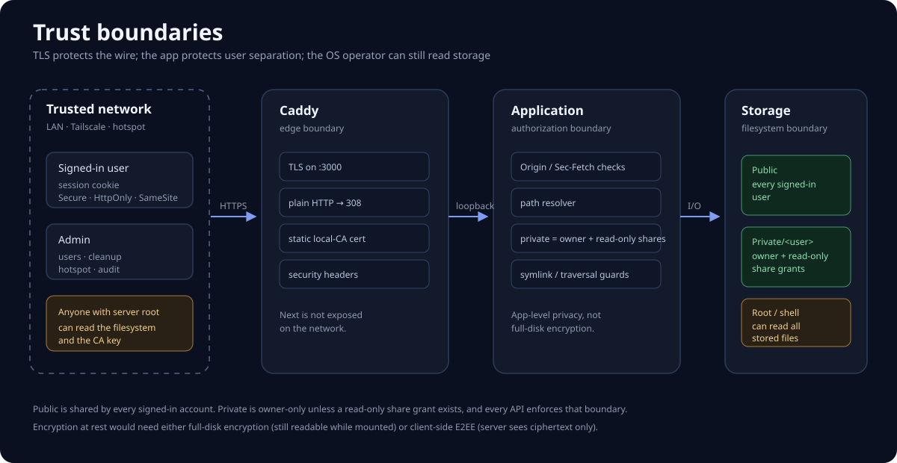

# Security model

CoveNet is designed for a **trusted private LAN** with a small number of known users.
It is not a public-internet service.

> See [SECURITY_AUDIT.md](SECURITY_AUDIT.md) for the latest test matrix and actions.
>
> **Current deployment: HTTPS on port 3000.** Caddy terminates TLS and proxies
> to Next on `127.0.0.1:3100`. Plain `http://` is redirected to HTTPS with a
> `308` before any app content is served. Each client must trust the local CA
> (`/cove-ca.crt`) once.

  

## What is protected

| Area | Control |
|---|---|
| Transport | TLS on port 3000 (Caddy internal CA); plain HTTP gets a `308` redirect; Next listens only on loopback `3100`; Tailscale adds WireGuard |
| Sessions | `__Host-cove` cookie: `Secure`, `HttpOnly`, `SameSite=Lax`; SHA-256 token hashes, 30-day absolute + 7-day idle expiry, 10-session cap, revoke-all |
| Passwords | bcrypt cost 12, minimum 8 chars with 3 character classes, no username, small common-password blocklist, forced change of the seeded default |
| Login | Generic errors, dummy-hash timing equalisation, persisted throttling (10 per account; 40 per IP via Caddy's overwritten `X-Forwarded-For`), 15-minute lock |
| Second factor | Optional TOTP (SHA-1, 6 digits, 30 s, ±1 window), QR/secret setup, admin reset |
| CSRF | SameSite=Lax plus `Origin`/`Sec-Fetch-Site` validation on every mutation |
| Browser | CSP, nosniff, SAMEORIGIN framing, no-referrer, Permissions-Policy, COOP/CORP, no `X-Powered-By` |
| Files | Canonicalised paths plus realpath checks inside the storage root (symlink escape blocked), chunk and total-size caps |
| Stored XSS | SVG/HTML/XML/JS/CSS served as `application/octet-stream` with `Content-Disposition: attachment` |
| Archives | ZIP walker refuses symlinks, so it cannot follow links outside the space |
| Authorisation | Every API re-checks the session and per-space access; Private paths map to the owner, while read-only shares are checked against explicit grants |
| Sharing | Private folders can be shared read-only with selected active users; recipients cannot write or re-share, and owner rename/move/delete revokes the grant |
| Audit | Logins, failures, uploads, deletes/restores, admin changes, password and 2FA events |

## Residual risks (accepted)

1. **Local CA onboarding.** New devices see a certificate warning until they
   install `cove-ca.crt` as a trusted root. A user who clicks through the warning
   instead is exposed to LAN interception. HSTS is intentionally not enabled yet
   so a client is not locked out before the CA is installed; add it after all
   clients trust the CA.
2. **The TLS certificate is static.** It is valid for 397 days and must be
   refreshed with `./deploy/issue-cert.sh` before expiry, or after a LAN/Tailscale
   IP change. Caddy's root CA is valid until 2036.
3. **Admin can reset passwords and 2FA**, and therefore can sign in as any user.
   This is inherent to a single-admin system; private folders are private from other
   *users*, not from the server operator.
4. **The app runs as the service user** with a NOPASSWD rule for the hotspot helper. A
   code-execution bug in Next.js, ffmpeg, ImageMagick or PDF.js could reach the
   user's home directory and the CA key. It cannot gain root directly, but the
   blast radius is large; a dedicated `cove` user is still recommended.
5. **Shell/root access to the machine reads everything** under `STORAGE_ROOT`.
   Privacy is enforced by the app, not the OS.
6. **CSP allows `'unsafe-inline'` for scripts/styles** because Next.js injects inline
   bootstrap code. External scripts and objects are still blocked; all user content is
   escaped or forced to download.
7. **Files are not encrypted at rest.** Full-disk encryption is recommended.
8. **No malware scanning.** Uploads are stored as-is; do not run untrusted binaries.
9. **Sharing is read-only and application-level.** Private folders can be
   granted to named users; recipients can download/copy content, and root can
   still read the underlying files. There are no public links or write grants.
10. **SSH is still password-authenticated.** UFW now scopes 22 to the LAN and
    Tailscale; use keys before exposing the machine. See
    [Operations](docs/OPERATIONS.md#firewall).
11. **Backups are on the same disk and unencrypted.** Use an external, encrypted
    destination.
12. **No per-user quota.** A signed-in user can fill the disk.

## Certificates

- `deploy/Caddyfile` serves `https://:3000` with a static certificate and proxies
  to `127.0.0.1:3100`.
- `deploy/issue-cert.sh` signs a 397-day leaf with Caddy's local root CA. SANs:
  `HOST.local`, `localhost`, `127.0.0.1`, `10.42.0.1`, the current LAN IP, the
  Tailscale IP and the MagicDNS name.
- The script copies the root CA to `public/cove-ca.crt` and restarts Caddy.
- Browsers need the root CA once. Keep the root CA private key on the server.

## Operational checklist

- [ ] Install the CoveNet CA on every client before using it
- [ ] Enable 2FA for the admin account
- [ ] Re-run `./deploy/issue-cert.sh` after an IP change and before it expires
- [ ] Restrict SSH to the LAN/Tailscale and use keys
- [ ] Point `BACKUP_DEST` at an external, ideally encrypted, destination
- [ ] Keep the OS, Node, ffmpeg and npm dependencies updated (`npm audit`)
- [ ] Do not expose port 3000 to the internet
- [ ] Review the audit log after adding users or changing roles

## Reporting

If you find a vulnerability, do not open a public issue with exploit details.
Contact the machine owner directly.
