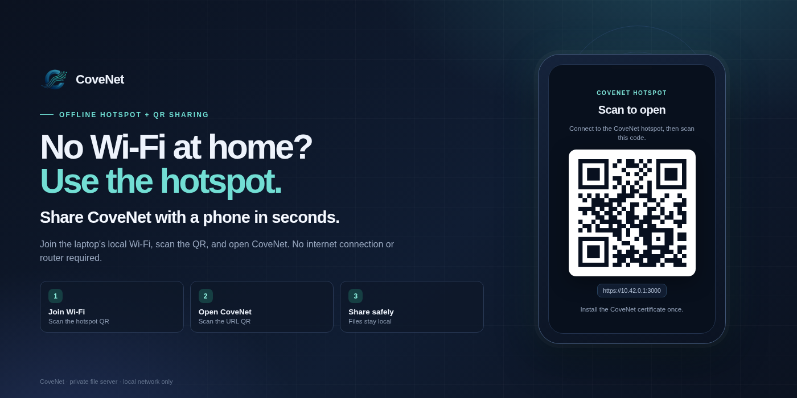

# CoveNet admin guide

The admin account manages users, storage, cleanup, the audit log and the offline
hotspot. The admin is still a normal user for Public/Private browsing: the admin
UI has no file browser for another user's Private folder.

For end-user actions, see the [User guide](USER_GUIDE.md). For install, services,
certificates and backups, see [Operations](OPERATIONS.md).

## Open the admin page

Sign in as an admin, then open **Manage users** in the account menu, or go to:

```
https://HOST.local:3000/admin
```

## Dashboard

The top cards show:

- disk free/total;
- size of Public and Private storage;
- Trash size;
- HLS video cache and thumbnail cache sizes.

Use **Run cleanup** to run the retention jobs immediately. Normal cleanup runs
every 6 hours and on the first page load.

## Create and manage accounts

### Create an account

1. Enter a username.
2. Set an initial password (at least 8 characters, three character classes).
3. Choose **User** or **Admin**.
4. Leave **Can upload** enabled unless the account must be read-only.
5. Click **Create**.

Give the password to the user through a safe channel. They can change it in
**Account security**.

### Roles and permissions

| Control | Effect |
|---|---|
| **Role: Admin** | Can open `/admin`, manage accounts, reset passwords/2FA, delete accounts, run cleanup and control the hotspot |
| **Role: User** | Can browse Public and their own Private space |
| **Can upload** | Allows file/folder/camera uploads; turning it off makes the account read-only |

Every admin can change every account; there is no separate "super admin" role.

### Reset a password

Use the **Reset** action on the account row and set a new password. Existing
sessions are revoked and the user must choose a new password at the next login.

### Reset two-factor authentication

Use the key/2FA action on the account row to remove that user's authenticator.
The user can set up 2FA again from **Account security**.

Do this only after verifying the user's identity. Removing 2FA lowers the
account's security.

### Disable or delete an account

- **Disable** blocks sign-in while keeping the account and files.
- **Delete** removes the account. Their Public files stay in Public; their
  Private folder is archived in Trash.

Deletion is destructive from the user's perspective. Confirm the username before
continuing.

## Account security

Every user, including admins, can open **Account security** to:

- change their password;
- enable/disable TOTP 2FA;
- sign out all sessions.

Enable 2FA for the admin account. If the authenticator is lost, another admin
can reset it.

## Audit log

**Recent activity** on the admin page shows recent login, upload, delete, admin
and security events, including the account and client IP. The audit database is
`data/app.db`; it is included in the SQLite backup.

The log is not a tamper-proof external SIEM. An attacker with server/root access
can alter it.

## Offline hotspot

<p align="center">
  
</p>

**No Wi-Fi at home? Use the CoveNet hotspot and QR codes to share easily.**
The hotspot turns the laptop into a local Wi-Fi network so phones can reach
CoveNet without internet.

### One-time setup

```bash
sudo ./scripts/install-hotspot.sh
```

This installs:

- the narrow root helper `/usr/local/bin/cove-hotspot`;
- a sudoers rule allowing only that helper;
- a UFW rule for hotspot DHCP.

It needs `dnsmasq` and a Wi-Fi adapter that supports AP mode. The helper is
intentionally narrow; do not replace it with a general sudo shell.

### Start and stop

Open **Admin → Offline hotspot** on the laptop, preferably at:

```
https://127.0.0.1:3000
```

Starting the hotspot disconnects the laptop from its current Wi-Fi, so open the
admin page at `https://127.0.0.1:3000/admin` first. Start is disabled on
non-local addresses; the request would be cut off when Wi-Fi changes.

1. Choose an SSID and password.
2. Click **Start hotspot**.
3. On the phone scan **1 · Join Wi-Fi**, then **2 · Open CoveNet**.
4. On a new phone, bypass the certificate warning once and install the CoveNet CA.

The QR URL is `https://10.42.0.1:3000`. The certificate includes that address.
Phones may warn that the hotspot has no internet; keep them connected.

The laptop has one Wi-Fi radio, so it loses its normal Wi-Fi/internet while the
hotspot runs. Use Ethernet or a second adapter if the laptop itself needs
internet at the same time.

Use **Stop hotspot** before reconnecting to normal Wi-Fi.

### If the hotspot IP is different

The helper normally uses `10.42.0.1`. If your configured subnet is different,
the certificate will not match that IP. Add the subnet to the certificate script
and re-run it, or use `https://HOST.local:3000` when the client supports mDNS.

## Cleanup and retention

Admins can trigger **Run cleanup**. It removes:

- stale incomplete uploads (`UPLOAD_STALE_HOURS`);
- expired Trash entries (`TRASH_RETENTION_DAYS`, default 30);
- **all HLS video cache**, including queued/running transcode work;
- **all thumbnail and preview cache**.

The scheduled cleanup (every 6 hours) still applies the age/size retention
settings, but the admin **Run cleanup** button clears the media caches
completely. Caches are rebuilt on demand.

Changing retention values requires editing `.env.local` and restarting the app.

## Storage and backups

The filesystem is the source of truth:

```
/srv/cove/files/Public/
/srv/cove/files/Private/<username>/
```

The database and caches live in `data/`. See [Operations](OPERATIONS.md#backups)
for backup and restore. The current backup destination is on the same disk, so
it does not protect against disk failure; use an external, encrypted destination
for real backups.

## Security checklist for admins

- [ ] Change the seeded admin password; do not reuse it.
- [ ] Enable 2FA for every admin.
- [ ] Keep `Can upload` off for accounts that only need to read.
- [ ] Review the audit log after adding users or changing roles.
- [ ] Do not expose port 3000 to the internet.
- [ ] Keep the OS, Node, ffmpeg, ImageMagick and npm packages updated.
- [ ] Verify backups can be restored, not only that they run.
- [ ] Apply the UFW rules in [Operations](OPERATIONS.md#firewall) and use SSH key authentication; see [Security](../SECURITY.md).
